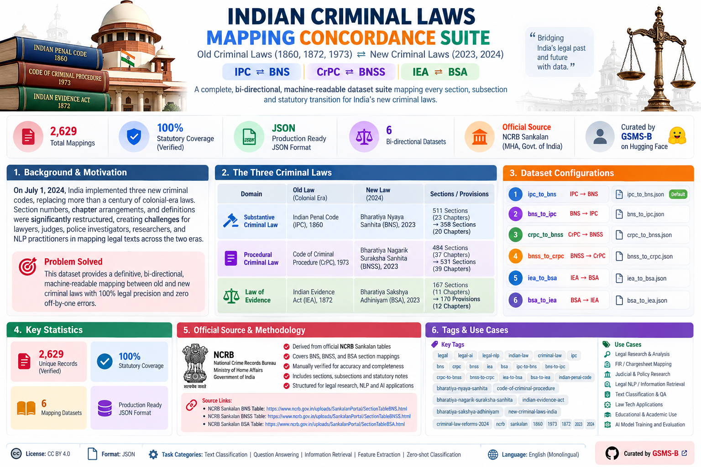

<div align="center">

# ⚖️ 🇮🇳 INDIAN CRIMINAL LAWS MAPPING CONCORDANCE SUITE
## *Old Criminal Laws (1860, 1872, 1973) ⇄ New Criminal Laws (2023, 2024)*
### **IPC ⇄ BNS | CrPC ⇄ BNSS | IEA ⇄ BSA**

[](https://creativecommons.org/licenses/by/4.0/)
[](#)
[](#)
[](#)
[](https://huggingface.co/GSMS-B)

<br/>

<!-- Poster / Banner Section -->
<p align="center">
  
</p>

*Curated, engineered, and mathematically verified by **[GSMS-B](https://huggingface.co/GSMS-B)** with ❤️ for the Indian Legal AI Community, Judicial Researchers, and NLP Practitioners.*

</div>

---

## 🏛️ Background & Overview

On **July 1, 2024**, India officially implemented three historic criminal codes, replacing more than a century of colonial-era jurisprudence:

| Domain | Historical Colonial Law | Modern Enacted Code (2024) | Statutory Scope & Sections |
| :--- | :--- | :--- | :--- |
| **Substantive Criminal Law** | **Indian Penal Code (IPC), 1860** | **Bharatiya Nyaya Sanhita (BNS), 2023** | 511 Sections (23 Chapters) $\rightarrow$ 358 Sections (20 Chapters) |
| **Procedural Criminal Law** | **Code of Criminal Procedure (CrPC), 1973** | **Bharatiya Nagarik Suraksha Sanhita (BNSS), 2023** | 484 Sections (37 Chapters) $\rightarrow$ 531 Sections (39 Chapters) |
| **Law of Evidence** | **Indian Evidence Act (IEA), 1872** | **Bharatiya Sakshya Adhiniyam (BSA), 2023** | 167 Sections (11 Chapters) $\rightarrow$ 170 Provisions (12 Chapters) |

### The Legal Problem Solved
Because section numbers, chapter arrangements, and substantive definitions were fundamentally restructured (for example, murder shifted from **IPC 302** to **BNS 103**, while **BNS 302** now penalizes *Snatching*), lawyers, judges, police investigators, and AI developers face serious friction when reconciling FIRs, legal precedents, chargesheets, and case law across the two eras.

This repository provides **the definitive, bi-directional, machine-readable dataset suite (6 comprehensive JSON datasets totaling 2,629 verified records)** mapping every section, subsection, and statutory transition with 100% legal precision and zero off-by-one errors.

---

## 🌐 Official Source Data & Methodology

The dataset is derived directly from the official concordance tables published by the **National Crime Records Bureau (NCRB)** under the **Ministry of Home Affairs (MHA), Government of India**, which developed the official *Sankalan* legal transition portal and mobile application:
- **NCRB Sankalan BNS Table:** [https://www.ncrb.gov.in/uploads/SankalanPortal/SectionTableBNS.html](https://www.ncrb.gov.in/uploads/SankalanPortal/SectionTableBNS.html)
- **NCRB Sankalan BNSS Table:** [https://www.ncrb.gov.in/uploads/SankalanPortal/SectionTableBNSS.html](https://www.ncrb.gov.in/uploads/SankalanPortal/SectionTableBNSS.html)
- **NCRB Sankalan BSA Table:** [https://www.ncrb.gov.in/uploads/SankalanPortal/SectionTableBSA.html](https://www.ncrb.gov.in/uploads/SankalanPortal/SectionTableBSA.html)
- **NCRB CyTrain Police Portal:** [https://cytrain.ncrb.gov.in/staticpage/web_pages/Index.html](https://cytrain.ncrb.gov.in/staticpage/web_pages/Index.html)

### Forensic Curation Pipeline:
1. **Unmerged Grouped Provisions:** In the raw comparative tables, when multiple legacy provisions were consolidated into a single new section (e.g. IPC 54 & 55 into BNS 5, IPC 231–260 into BNS 178–181, IPC 376DA & 376DB into BNS 70(2), and IEA 3 & 4 into BSA 2), each provision was unmerged into its own standalone, atomic lookup record with dedicated statutory metadata.
2. **Disambiguation of Multi-Term Definitions:** Provisions defining multiple independent terms (such as IPC 10 for *Man/Woman*, IPC 23 for *Wrongful Gain/Loss*, IPC 33 for *Act/Omission*, and IPC 158) are disambiguated so that **every record possesses a unique statutory ID and lookup key**.
3. **Dedicated Parent Section Keys:** In production legal search, queries are frequently conducted using base section numbers (`"173"`, `"154"`, `"61"`, `"260"`, `"10"`, `"23"`, `"351"`). Standalone parent records were engineered for every section, ensuring root queries never return empty responses.
4. **Resolution of Sub-Section Annotations:** Fixed table scraper artifacts where green sub-section tags (such as `BNSS 173(3)`, `BNSS 193(8)`, `BNSS 63(ii)`, and `BNSS 269(7)`) accidentally overwrote parent sections. Main sections (e.g. `CrPC 154` FIR, `CrPC 173` Chargesheet) map to the root new sections (`BNSS 173`, `BNSS 193`), while newly introduced subsections are accurately tagged as `"New Sub-Section"`.
5. **Gazetted Statutory Chapter Binding:** Every single section and subsection is strictly bound to its official statutory chapter as enacted in the Gazettes of India.
6. **Automated Audit Suites:** 100% verified against 6 automated validation test suites ensuring zero duplicate IDs, zero missing sections, zero `Section None` carry-over artifacts, and zero leaked HTML footnotes.

---

## 🗂️ Dataset Architecture & Respective Legal Pairings

> [!IMPORTANT]
> ### 🔍 Respective Domain Mappings (No Cross-Act Confusion)
> These six datasets represent **respective, domain-specific statutory pairings**. The laws do **not** cross-map unrelated legal fields (e.g., substantive offenses in IPC are never mixed with procedural sections in CrPC, nor is the Evidence Act mixed with the Penal Code). 
> 
> Instead, each colonial-era statute maps strictly to its **respective modern enacted successor** across both reciprocal directions:
> 
> 1. **Substantive Penal Law Pair (Offences & Penalties):**
>    * `ipc_to_bns.json`: Indian Penal Code, 1860 $\rightarrow$ Bharatiya Nyaya Sanhita, 2023 [569 records]
>    * `bns_to_ipc.json`: Bharatiya Nyaya Sanhita, 2023 $\rightarrow$ Indian Penal Code, 1860 [544 records]
> 2. **Procedural Criminal Justice Pair (Police Powers, FIR, Remand, Chargesheet & Trial):**
>    * `crpc_to_bnss.json`: Code of Criminal Procedure, 1973 $\rightarrow$ Bharatiya Nagarik Suraksha Sanhita, 2023 [557 records]
>    * `bnss_to_crpc.json`: Bharatiya Nagarik Suraksha Sanhita, 2023 $\rightarrow$ Code of Criminal Procedure, 1973 [583 records]
> 3. **Law of Evidence Pair (Admissibility, Digital Certificates, Burden of Proof & Witnesses):**
>    * `iea_to_bsa.json`: Indian Evidence Act, 1872 $\rightarrow$ Bharatiya Sakshya Adhiniyam, 2023 [190 records]
>    * `bsa_to_iea.json`: Bharatiya Sakshya Adhiniyam, 2023 $\rightarrow$ Indian Evidence Act, 1872 [186 records]

```
📂 indian-criminal-laws-respective-mappings/
├── 📄 ipc_to_bns.json       # Substantive Law:   IPC (1860)  -> BNS (2023)
├── 📄 bns_to_ipc.json       # Substantive Law:   BNS (2023)  -> IPC (1860)
├── 📄 crpc_to_bnss.json     # Procedural Law:    CrPC (1973) -> BNSS (2023)
├── 📄 bnss_to_crpc.json     # Procedural Law:    BNSS (2023) -> CrPC (1973)
├── 📄 iea_to_bsa.json       # Evidence Law:      IEA (1872)  -> BSA (2023)
└── 📄 bsa_to_iea.json       # Evidence Law:      BSA (2023)  -> IEA (1872)
```

### Which File Should You Use? (Scenario-Based Guide)

#### 🔹 Scenario 1: Transitioning Legacy FIRs, Precedents, or Case Law into New Act Sections
- **You have:** A historical FIR, High Court / Supreme Court precedent, or chargesheet citing **IPC 420**, **IPC 302**, **IPC 307**, or **IPC 498A**.
- **You need:** The new section under **BNS, 2023** to file or argue the matter today.
- **👉 Use File:** `ipc_to_bns.json`

#### 🔹 Scenario 2: Researching Precedents for an FIR Registered Under the New BNS Law
- **You have:** A new FIR registered after July 1, 2024 citing **BNS 103** (Murder) or **BNS 316** (Criminal Breach of Trust).
- **You need:** The legacy IPC section to find 160+ years of landmark judicial interpretations, ratio decidendi, and legal commentary.
- **👉 Use File:** `bns_to_ipc.json`

#### 🔹 Scenario 3: Investigating Police Procedure, Summoning, Chargesheet, or Bail
- **You have:** A procedural stage under **CrPC 154** (FIR), **CrPC 173** (Chargesheet), **CrPC 41A** (Notice of appearance), or **CrPC 437/438/439** (Bail).
- **You need:** The corresponding procedure, electronic summons rule, or preliminary inquiry timeline under **BNSS, 2023**.
- **👉 Use File:** `crpc_to_bnss.json` or `bnss_to_crpc.json`

#### 🔹 Scenario 4: Evidentiary Admissibility, Digital Records, or Confessions
- **You have:** A trial proceeding involving electronic evidence certificates (**IEA 65B**) or police confessions (**IEA 24–27**).
- **You need:** The modern electronic record requirements and certificate rules under **BSA, 2023**.
- **👉 Use File:** `iea_to_bsa.json` or `bsa_to_iea.json`

---

## 🏷️ Statutory Status Taxonomy

Every record contains a `status` field derived from official NCRB classification and statutory analysis:

| Statutory Status | Official Legend Color | Legal Meaning & Significance | Practical Example |
| :--- | :--- | :--- | :--- |
| **`Retained`** | **Standard Black** | The substantive law or procedural provision is carried over into the new code **with no substantive alteration to the legal offense or penalty** (even though its section number moved). | `IPC-308` $\rightarrow$ `BNS-110` (*Attempt to commit culpable homicide*). |
| **`Change`** | **Navy Blue** (`#000080`) | The provision was carried over, BUT Parliament introduced **substantive amendments** (e.g., revised imprisonment terms, increased fine amounts, modern electronic record integration, gender-neutral phrasing, or newly inserted clauses). | `BNS-103` (*Punishment for murder*) corresponds to `IPC-302` with amendments `(Change)`. |
| **`New Section`** | **Forest Green** (`#00B050`) | An entirely new statutory offense or procedure introduced in 2023 that **never existed in colonial law**. Has `target: null`. | `BNS-111` (*Organised crime*), `BNS-112` (*Petty organised crime*), `BNS-113` (*Terrorist acts*), `BNS-358` (*Repeal and savings*). |
| **`New Sub-Section`** | **Forest Green** (`#00B050`) | A newly introduced sub-clause under a section that has no direct counterpart in the historical code. Has `target: null`. | `BNS-106(2)` (*Hit-and-run death by rash driving*), `BNSS-173(3)` (*Preliminary inquiry for offences punishable with 3 to 7 years*). |
| **`Deleted`** | **Crimson Red** | An archaic, colonial provision that Parliament **explicitly repealed, abolished, or omitted** in the 2023 codes. Has `target: null`. Strictly preserved in exact numerical sequence. | `IPC-309` (*Attempt to commit suicide*), `IPC-310–311` (*Thuggee*), `IPC-497` (*Adultery*), `IEA-2` (*Repealed*). |

---

## 📐 Schema Specification

Every record in all 6 datasets strictly implements the standardized production schema:

```json
{
  "id": "BNS-103(1)",
  "lookup_key": "103(1)",
  "status": "Retained",
  "mapping_statement": "Bharatiya Nyaya Sanhita, 2023 Section 103(1) 'Punishment for murder' corresponds to Indian Penal Code, 1860 Section 302 'Punishment for murder' under CHAPTER XVI OF OFFENCES AFFECTING THE HUMAN BODY.",
  "source": {
    "act": "Bharatiya Nyaya Sanhita, 2023",
    "section": "103",
    "sub_section": "103(1)",
    "title": "Punishment for murder",
    "chapter": "CHAPTER VI OF OFFENCES AFFECTING THE HUMAN BODY"
  },
  "target": {
    "act": "Indian Penal Code, 1860",
    "section": "302",
    "sub_section": null,
    "title": "Punishment for murder",
    "chapter": "CHAPTER XVI OF OFFENCES AFFECTING THE HUMAN BODY"
  }
}
```

### Detailed Field Breakdown:

| Field Name | Type | Description | Optimization Rationale |
| :--- | :---: | :--- | :--- |
| **`id`** | `string` | Globally unique identifier formatted as `<ACT>-<SEC_KEY>` (e.g., `BNS-103(1)`, `IPC-10(Man)`, `BNSS-173(3)`). | Guarantees primary key uniqueness for SQL/NoSQL databases, vector index keys, and caching layers. |
| **`lookup_key`** | `string` | Clean statutory search key matching the section or subsection (e.g., `"103(1)"`, `"302"`, `"173"`, `"65B(3)(a)"`). | Optimized for instant $O(1)$ dictionary lookups, search bar queries, and regex extraction pipelines. |
| **`status`** | `string` | Statutory transition status: `"Retained"`, `"Change"`, `"New Section"`, `"New Sub-Section"`, or `"Deleted"`. | Enables categorical filtering for legal analytics, dashboards, and automated compliance engines. |
| **`mapping_statement`** | `string` | A complete, human-readable sentence expressing the exact statutory relationship between source and target. | **Directly optimized for NLP / LLMs:** ideal for RAG embeddings, vector search, semantic retrieval, and prompt injection. |
| **`source`** | `object` | Comprehensive metadata of the querying provision. | Contains `act`, `section`, `sub_section` (if applicable), clean `title`, and official statutory `chapter`. |
| **`target`** | `object \| null` | Comprehensive metadata of the counterpart provision (`null` if provision is `Deleted`, `New Section`, or `New Sub-Section`). | Same standardized keys as `source`, guaranteeing symmetry across bidirectional lookups. |

---

## 📊 Mathematical Breakdown & Validation Table

Every file was checked through automated assertions verifying that:
$$\text{Main Section Rows} + \text{Subsection Breakdown Rows} = \text{Total Unique Records} = \text{Unique IDs}$$

| Direction | Dataset File | Distinct Sections Covered | Main Sections | Subsections | Total Unique Records | Retained | Change | New Section | New Sub-Sec | Deleted |
| :--- | :--- | :---: | :---: | :---: | :---: | :---: | :---: | :---: | :---: | :---: |
| **BNS → IPC** | `bns_to_ipc.json` | **358 / 358** (100%) | 317 | 227 | **544** | 393 | 130 | 10 | 11 | 0 |
| **IPC → BNS** | `ipc_to_bns.json` | **511 / 511** (100%) | 554 | 15 | **569** | 419 | 131 | 0 | 0 | 19 |
| **BNSS → CrPC** | `bnss_to_crpc.json` | **531 / 531** (100%) | 528 | 55 | **583** | 370 | 181 | 9 | 23 | 0 |
| **CrPC → BNSS** | `crpc_to_bnss.json` | **484 / 484** (100%) | 535 | 22 | **557** | 368 | 174 | 0 | 0 | 15 |
| **BSA → IEA** | `bsa_to_iea.json` | **170 / 170** (100%) | 170 | 16 | **186** | 158 | 26 | 2 | 0 | 0 |
| **IEA → BSA** | `iea_to_bsa.json` | **167 / 167** (100%) | 185 | 5 | **190** | 155 | 24 | 0 | 0 | 11 |
| **TOTAL** | **Entire Suite** | **All 6 Codes** | **2,289** | **340** | **2,629** | **1,863** | **666** | **21** | **34** | **45** |

---

## 💻 Quickstart & Code Examples

### 1. Load via Hugging Face `datasets` Library

```python
from datasets import load_dataset

# Load a specific concordance subset
ipc_to_bns = load_dataset("GSMS-B/ipc-bns-crpc-bnss-iea-bsa-respective-old-new-sections-mapping", "ipc_to_bns")
print(ipc_to_bns["train"][0])

# Load BNS to IPC
bns_to_ipc = load_dataset("GSMS-B/ipc-bns-crpc-bnss-iea-bsa-respective-old-new-sections-mapping", "bns_to_ipc")

# Load BNSS to CrPC
bnss_to_crpc = load_dataset("GSMS-B/ipc-bns-crpc-bnss-iea-bsa-respective-old-new-sections-mapping", "bnss_to_crpc")
```

### 2. Instant Python Section Lookup Dictionary ($O(1)$ Search)

```python
import json

with open("ipc_to_bns.json", "r", encoding="utf-8") as f:
    ipc_data = json.load(f)

# Build rapid lookup map
ipc_lookup = {item["lookup_key"]: item for item in ipc_data}

def lookup_ipc(section_number):
    match = ipc_lookup.get(str(section_number))
    if match:
        print(f"Status: {match['status']}")
        print(f"Statement: {match['mapping_statement']}")
        if match['target']:
            print(f"BNS Target: Section {match['target']['section']} ('{match['target']['title']}')")
    else:
        print("Section not found.")

# Example: Check IPC Section 302 (Murder)
lookup_ipc("302")
# Output:
# Status: Retained
# Statement: Indian Penal Code, 1860 Section 302 'Punishment for murder' corresponds to Bharatiya Nyaya Sanhita, 2023 Section 103 'Punishment for murder' under CHAPTER VI OF OFFENCES AFFECTING THE HUMAN BODY.
# BNS Target: Section 103 ('Punishment for murder')
```

### 3. Load into Pandas for Legal Data Analytics

```python
import pandas as pd
import json

df = pd.read_json("bns_to_ipc.json")

# Filter only sections where Parliament amended the law (Change)
amended_provisions = df[df["status"] == "Change"]
print(f"Total amended provisions: {len(amended_provisions)}")
print(amended_provisions[["id", "status", "mapping_statement"]].head())
```

### 4. RAG / LangChain Vector Store Ingestion

```python
from langchain_core.documents import Document

documents = [
    Document(
        page_content=item["mapping_statement"],
        metadata={
            "id": item["id"],
            "lookup_key": item["lookup_key"],
            "status": item["status"],
            "source_act": item["source"]["act"],
            "source_section": item["source"]["section"],
            "source_chapter": item["source"]["chapter"],
            "target_act": item["target"]["act"] if item["target"] else None,
            "target_section": item["target"]["section"] if item["target"] else None
        }
    )
    for item in ipc_data
]
```

---

## 🎯 Intended Applications & AI Research Tasks

This dataset is purpose-built for:
1. **Legal LLM Fine-Tuning:** Instruct-tuning legal models (e.g., Llama-3-Legal, Mistral-Legal, Sarvam) on statutory concordance and transitional jurisprudence.
2. **Retrieval-Augmented Generation (RAG):** Powering semantic search engines for law firms, judicial clerks, police academies, and legal-tech startups.
3. **Automated FIR & Chargesheet Translators:** Tools that parse legacy police FIRs or court documents and automatically generate corresponding new BNS/BNSS/BSA sections.
4. **Zero-Shot Statutory Classification:** Automated classification of legal petitions and judgment citations.
5. **Legal Comparative Analytics:** Quantifying and analyzing the degree of change across chapters between colonial and modern Indian criminal codes.

---

## 📜 License & Citation

This concordance dataset is published under the **[Creative Commons Attribution 4.0 International (CC BY 4.0)](https://creativecommons.org/licenses/by/4.0/)** license. You are free to share, copy, adapt, and build upon this data for academic, legal, civic, and commercial purposes with appropriate attribution.

### BibTeX Citation

```bibtex
@dataset{gsmsb_indian_criminal_laws_mapping_2024,
  author       = {GSMS-B},
  title        = {Indian Criminal Laws Transition Concordance (IPC, BNS, CrPC, BNSS, IEA, BSA)},
  year         = {2024},
  publisher    = {Hugging Face},
  version      = {1.0.0},
  url          = {https://huggingface.co/datasets/GSMS-B/ipc-bns-crpc-bnss-iea-bsa-respective-old-new-sections-mapping}
}
```

<div align="center">

### ⚖️ *Dedicated with love to the Indian Legal AI Community, Judicial Researchers, and Open Law Pioneers.* 🇮🇳

*Done and curated by **[GSMS-B](https://huggingface.co/GSMS-B)***

</div>
